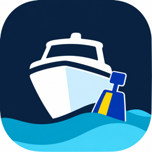

# signalk-vesseltwin



[VesselTwin](https://vesseltwin.io) keeps your boat's maintenance record in one place. This
[SignalK](https://signalk.org) server plugin connects your boat's SignalK server to your VesselTwin
account and, when you turn it on, sends engine hours, battery readings and tank levels to that record.

> **Status: version 0.2.1, published on npm.** Connecting your boat works, and the plugin can send
> engine and generator run time, battery voltage and charge, and tank levels once the owner turns
> sending on (it is off by default). **Sending readings is off until you turn it on** in the plugin settings, and nothing is
> sent before then. After the first readings arrive, you map and confirm each channel in the
> VesselTwin app before anything is recorded to the maintenance record. The SignalK Appstore listing can
> take a while to appear.

## Requirements

Node.js 20.3 or newer (this includes Victron Venus OS on a Cerbo GX) and signalk-server 2.x. Sending
readings also needs a signalk-server that offers plugins a subscription manager (every 2.x release
does); if yours does not, the status line says so.

Using this plugin requires a [VesselTwin](https://vesseltwin.io) account on the **Pro plan**. Accounts on
other plans cannot pair, and sending readings is unavailable until the plan allows it.

## Install

SignalK admin UI > Appstore > search "VesselTwin" > Install > restart the server. Then enable it
under Server > Plugin Config. If the Appstore does not list it yet, install `signalk-vesseltwin`
from npm into your SignalK configuration folder and restart the server:

```sh
cd ~/.signalk
npm install signalk-vesseltwin
```

The plugin has no runtime dependencies, so nothing else is installed with it. Use the folder your
server actually uses if it is not `~/.signalk` (for example the mounted configuration volume in
Docker).

## Connect your boat

Connecting requires a VesselTwin account ([sign up at vesseltwin.io](https://vesseltwin.io)) on the
**Pro plan**. Accounts on other plans cannot pair, and the integration may not be available to every
account yet.

The plugin adds a **VesselTwin** page to the SignalK admin UI. **Pair as an admin, with SignalK
security enabled** (see below).

1. Enable the plugin under Server > Plugin Config in the SignalK admin UI.
2. Open **Webapps > VesselTwin** (the VesselTwin tile appears once the plugin is enabled). Sign in to
   SignalK as an administrator if the page asks you to.
3. Choose **Pair**. The page shows a short code such as `ABCD-EFGH` and a link to VesselTwin. The code
   is shown only on this admin-only page and not in the plugin's status line on purpose: SignalK
   shows the status line to every client, including read-only and anonymous ones.
4. Open the link, sign in to VesselTwin, enter the code, choose your boat, and approve.
5. The plugin picks up the approval within a few seconds and then checks the connection. The page
   and the status line show `Paired with ...` once that works.

Without a browser (headless servers), the same steps work over HTTP as an admin: `POST
/plugins/signalk-vesseltwin/pair` starts pairing and `GET /plugins/signalk-vesseltwin/status` returns
`pairing.userCode` and `pairing.verificationUrl`. From a checkout of this repository,
`node dev/pair.mjs --no-approve` does this for you.

Choose **Cancel** on the page to abandon a pending pairing. If you approve in VesselTwin just as you
press Cancel, the approval may still go through on the VesselTwin side. If VesselTwin then lists the
connection but this page does not show the boat as paired, remove that connection in VesselTwin.

The code expires after 10 minutes. If it does, start pairing again.

The plugin's endpoints (`status`, `pair`, `unpair`) rely on the SignalK server's own access control
(see Security below). The page's own files (HTML, CSS, scripts) are public static files and contain
no secrets; with SignalK security enabled, every request to the plugin needs the admin login (with security off,
the endpoints are open to anyone on the LAN).

**Unpair** (on the page, with a confirmation step, or `POST /plugins/signalk-vesseltwin/unpair`) only removes the stored connection on this
server. Also revoke the connection in VesselTwin so it stops working there; the plugin cannot do that
for you.

## Send readings to VesselTwin

Pairing alone sends no readings. Sending readings is off until you turn it on, and each kind of
reading is a separate choice.

1. Pair first (see "Connect your boat").
2. Open Server > Plugin Config > VesselTwin.
3. Turn on **Send readings to VesselTwin**. This is the master switch; with it off nothing is
   recorded or sent, whatever else is set.
4. Turn on the categories you want, each off by default: **Engine and generator hours**, **Battery
   readings** (voltage and state of charge) and **Tank levels** (level and volume).
5. For each category choose **Record from**: **All instances**, or **Only the ids listed**. Instance
   ids are the names SignalK uses in its paths, for example `main` for `propulsion.main.runTime`,
   `house` for `electrical.batteries.house.voltage`, and `fuel.0` for `tanks.fuel.0.currentLevel`
   (the tank type, a dot, then the tank id). A list with no valid entries records nothing for that
   category.
6. Save. SignalK restarts the plugin and the status line says `Sending readings to VesselTwin.`

The first readings go out a few minutes after the plugin starts, then at most once a day by default
(you can set a shorter send interval). Each channel records at most once an hour at the fastest
setting, and by default once a day.

### Set up channels in VesselTwin

A reading is not recorded to your maintenance record just because the plugin sent it. VesselTwin
keeps new channels on hold until you map each one to the right piece of equipment (for example, the
channel for `main` to your port engine) and confirm it in the VesselTwin app. While channels are
waiting, the status line says `Some channels need setup in VesselTwin.` and the VesselTwin page in
the SignalK admin UI (Webapps > VesselTwin) shows how many. Open the VesselTwin app and finish the
setup there.

### If you used version 0.1.1

Older versions saved `sendEngineHours`, `sendBatteries` and `sendTanks` settings, but they never sent
anything. Those settings now do nothing, so upgrading does not start sending. If any were on, the
VesselTwin page says "Sending readings now needs to be turned on again in the plugin settings."
Follow the steps above if you want readings sent.

## What the status line means

The status line is under Server > Plugin Config (and on the Webapps > VesselTwin page). It is shown
to every SignalK client, so it never carries counts, codes or web addresses; the VesselTwin
page, which is admin-only, shows the details.

**Not connected yet**

- _Not paired. Open VesselTwin under Webapps in the SignalK admin UI to pair._ Nothing is connected.
  Follow "Connect your boat" above.
- _Pairing in progress._ A code is waiting for your approval. Open Webapps > VesselTwin as an
  administrator to see it. The code never appears in the status line.
- _Pairing finished but the connection could not be saved_ / _The pairing code expired_ / _Pairing
  was declined_ / _VesselTwin is busy_ / _VesselTwin is not available right now_ / _VesselTwin sent
  an unexpected answer_: pairing did not complete. The message says what to do; most of the time you
  start pairing again (**Try again** on the page).

**Connected**

- _Paired with (your boat)_ (or _Paired with VesselTwin_): the connection is valid and is re-checked
  about once an hour. The rest of the line says what happens to readings:
  - _Sending readings to VesselTwin._ Sending is on.
  - _Sending is on; waiting for readings from SignalK._ Sending is on but nothing has been recorded
    yet (no matching values have arrived). It switches to the line above once a reading is recorded
    or sent.
  - _Some channels need setup in VesselTwin._ Added when channels are waiting for you to map them in
    the VesselTwin app (see "Set up channels in VesselTwin").
  - _Sending readings is off in the plugin settings._ Nothing is sent. See "Send readings to
    VesselTwin" to turn it on.
  - _This SignalK server cannot provide readings to the plugin._ This server does not offer plugins
    a subscription manager, so nothing can be collected. Update signalk-server.
- _Checking the connection_: shown briefly after pairing and after a restart.
- _This device's clock differs from VesselTwin's. Check the date and time._ Fix the clock on the
  server.

Plugin updates are announced in the SignalK Appstore when released; the status line does not
announce them.

**Connected but not working right now (the plugin keeps checking by itself)**

- _The connection is paused for your VesselTwin plan_ or _VesselTwin integrations are not available
  for your account right now_: your VesselTwin plan doesn't include integrations right now, or
  integrations are turned off for your account. The plugin keeps checking and resumes by itself.
- _Cannot reach VesselTwin right now_: a network problem or VesselTwin is down. The plugin retries
  with growing pauses.

While sending is on, these two lines end with _Readings are kept for up to 7 days._ Readings wait in
a queue on this server and are sent when the connection works again; after 7 days, or beyond 50,000
waiting readings, the oldest are dropped first. Nothing is queued while sending is off.

**Needs your action**

- _This plugin version is not supported by VesselTwin. Update the plugin._ Update it from the
  SignalK Appstore (or install the newer version from npm) and restart.
- _Pairing with VesselTwin is no longer valid. Pair again._ VesselTwin no longer accepts the stored
  connection (revoked, expired, or removed). See "Unpair and pair again" below.
- _The VesselTwin API address changed since pairing._ The stored connection was issued for another
  address. Restore the previous address in the plugin settings, or pair again (pairing again
  replaces the stored connection).
- _Cannot read the stored VesselTwin connection. Check the permissions of the plugin data folder._
  The plugin cannot read its own data folder.
- A settings message (for example an invalid API address): open the plugin settings and fix it. The
  plugin makes no network calls until it is fixed.

When VesselTwin rejects the stored connection, the plugin removes the secret from its data folder
and keeps only a marker, so it does not try the old credential again after a restart. An unexpected
rejection that does not come from VesselTwin itself (for example from a proxy) also stops the
checks, but leaves the stored connection in place.

## Unpair and pair again

To disconnect, or to start over after a "pair again" message:

1. Open **Webapps > VesselTwin** in the SignalK admin UI, signed in as an administrator.
2. Choose **Unpair** and confirm. This removes the stored connection on this server only.
3. In VesselTwin, remove the connection for this boat so it stops working there too. The plugin
   cannot do that for you.
4. To connect again, choose **Pair** on the page and follow steps 3 to 5 of "Connect your boat".

If the status says pairing is no longer valid, the page offers **Pair again** (and **Unpair**).
**Pair again** starts a new pairing right away and, once you approve it, replaces the old stored
connection. Remove the old connection in VesselTwin afterwards if it is still listed.

## Security

Pair from the SignalK admin UI with **SignalK security enabled**. With security enabled the plugin's
endpoints are admin-only by default (verified on signalk-server 2.33), and the plugin never lowers that. With security off, anyone who can reach your
server can read the pairing code and start pairing, and the plugin's browser same-origin check does
not protect against non-browser clients. The plugin does not block pairing in that case, so enable
SignalK security before you pair.

## What it sends (privacy)

- **Never sent: position, tracks, MMSI, callsign, vessel or crew names, free text, or any AIS data.**
  The plugin does not subscribe to or read those paths.
- **Readings** are sent only when **Send readings to VesselTwin** is on and a category is turned on,
  and only for the categories and instances you chose. Each reading carries exactly four things: the
  SignalK path (which includes the instance id you use, such as `propulsion.main.runTime`), the raw
  SI value as SignalK reports it (seconds, volts, a ratio, cubic metres), a UTC timestamp of when it
  was recorded, and a random reading id. The paths come from a closed list of engine and generator run
  time, battery voltage and state of charge, and tank level and volume. Timestamps reveal when
  equipment runs: engine hours that change between two readings show that the engine was used in
  that period.
- **Pairing** sends only: the provider (`"signalk"`), the plugin name and version, the contract
  version, the fixed device label "SignalK server", the requested scope, and optionally your SignalK server's own random install
  UUID, which is the vessel's SignalK self id (`urn:mrn:signalk:uuid:...`). A random UUID like this
  does not identify you or the boat by itself. It is sent only if the self id is a UUID (bare or
  with that prefix); an MMSI-based id or anything else is left out. Nothing else is sent before you
  approve.
- **Status check**: after pairing, on start and about once an hour, the plugin makes an authenticated
  request that asks VesselTwin whether the connection is still valid and which plugin versions it
  supports. It carries the credential and the contract version and **no boat data**.
- The credential is stored in the plugin's data directory with mode `0600`, never in plugin
  settings, and is never written to logs. It is bound to the API URL it was issued for and is sent
  only there. Redirects are never followed.
- Data is only sent to the API URL in the plugin settings (default `https://api.vesseltwin.io`). If
  that URL is invalid, the plugin reports a configuration error and makes no network calls.
- Readings wait in plain files in the plugin's data directory until they are sent (up to 7 days).
  Turning sending off, restarting with it off, or unpairing deletes the waiting readings.

### Sending settings

All categories and the master switch are off by default.

- **Send readings to VesselTwin**: the master switch. Nothing is recorded or sent while it is off.
- **Per category** (Engine and generator hours, Battery readings, Tank levels): turn it on or off,
  set how often it may record (every 60 to 1440 minutes, default once a day), and set a minimum
  change worth recording (hours, volts, percent or litres). A reading is also recorded after 24 hours
  even without a change.
- **Record from**: all instances, or only the ids you list. Ids use letters, digits, underscore or
  hyphen, up to 40 characters. Tank ids are the tank type, a dot, then the id, for example `fuel.0`;
  the type is one of `fuel`, `freshWater`, `wasteWater`, `blackWater`, `lubrication`, `liveWell`,
  `baitWell`, `gas` or `ballast`.
- **Limits**: at most 24 readings per channel per day, and at most 64 channels in total. The first
  64 channels seen are used; the rest are ignored.
- **Send to VesselTwin at most every** (5 to 1440 minutes, default 1440) and **Offline queue cap**
  (1000 to 50000 readings, default 50000).

The admin-only status response lists each category as configured (`enabled`) and effective (`active`),
and any notes about them, for example ignored instance ids.

## Troubleshooting

- **"Unavailable" while pairing, or a paused connection.** Your VesselTwin plan doesn't include
  integrations right now, or integrations are turned off for your account. The plugin keeps working and checks again later; try pairing again
  later.
- **Nothing arrives in VesselTwin.** Check the status line. _Sending readings is off in the plugin
  settings_: turn on the master switch and a category. _Some channels need setup in VesselTwin_:
  map and confirm them in the VesselTwin app. Readings only start after the first one is recorded
  (up to a few minutes after the plugin starts, then once a day by default).
- **Downgrading to 0.1.x.** Turn sending off first, so waiting readings are deleted: 0.1.x does not
  manage the queue folder.
- **No reading after the SignalK server restarted.** SignalK keeps current values in memory only,
  so a reading appears once the device sends a value again (for example, engine hours show up the
  next time the engine runs). Restarting or re-saving the plugin is fine: it picks up current
  values and doesn't send unchanged ones twice.
- **"Readings are kept for up to 7 days".** The connection is paused or offline and readings are
  waiting on this server. They are sent when it works again.
- **"Update the plugin".** VesselTwin no longer supports this plugin version. Update it from the
  SignalK Appstore (or install the newer version from npm) and restart. Waiting readings are kept.
- **"Pair again".** See "Unpair and pair again". Waiting readings are kept until you pair again;
  a new pairing starts with an empty queue.
- **Disconnect or revoke.** Unpair removes the stored connection on this server; also revoke it in
  VesselTwin.
- **Asked to pair again.** VesselTwin no longer accepts the stored connection (revoked, expired, or it
  was issued for a different API URL). Start pairing again; the new connection replaces the old one.

## Contributing

Build instructions and the development workflow are in [CONTRIBUTING.md](CONTRIBUTING.md). The
wire contract is described in [docs/api.md](docs/api.md).

## License

Apache-2.0. See [LICENSE](LICENSE).
