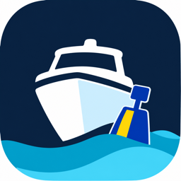

# VesselTwin for Signal K



[VesselTwin](https://vesseltwin.io) keeps your boat's record in one place. This
[Signal K](https://signalk.org) server plugin sends engine hours, battery readings, and tank levels
from your boat's Signal K server to that record, so hour-based service comes due on real hours.

- **Sends**: engine and generator run time, battery voltage and charge, and tank levels, only for
  the categories you turn on.
- **Never sends**: position, tracks, MMSI, callsign, vessel or crew names, free text, or any AIS data.
- **Off by default**: pairing alone sends no readings.

> **Status: version 0.2.2, published on npm.** Connecting your boat works, and the plugin can send
> engine and generator run time, battery voltage and charge, and tank levels once the owner turns
> sending on (it is off by default). **Sending readings is off until you turn it on** in the plugin
> settings, and nothing is sent before then. After the first readings arrive, you map and confirm
> each sensor in the VesselTwin app before anything is recorded to your boat's record.

> VesselTwin is in early access — features, availability, and pricing may change as we learn from early owners.

## What you need

- A [VesselTwin](https://vesseltwin.io) account on the Owner Pro plan. Accounts on other plans
  can't connect a device, and the plugin can't send readings until the plan allows it.
- A Signal K server, `signalk-server` 2.x, running Node.js 20.3 or newer. Sending readings also
  needs a server that offers plugins a subscription manager (every 2.x release does). If yours
  doesn't, the status line says so.
- Signal K security turned on, recommended. See [Security](#security).

## Install

In the Signal K admin UI, open Appstore, search for "VesselTwin", choose Install, and restart the
server.

If the Appstore doesn't list it, install `signalk-vesseltwin` from npm into your Signal K
configuration folder and restart the server:

```sh
cd ~/.signalk
npm install signalk-vesseltwin
```

Use the folder your server actually uses if it isn't `~/.signalk` (for example, the mounted
configuration volume in Docker). The plugin has no runtime dependencies, so nothing else is
installed with it.

## Connect your boat

Pair as an administrator, with Signal K security turned on.

1. Enable the plugin under Server > Plugin Config in the Signal K admin UI.
2. Open **Webapps > VesselTwin**. Sign in to Signal K as an administrator if the page asks you to.
3. Choose **Pair**. The page shows a short code such as `ABCD-EFGH` and a link to VesselTwin. The
   code appears only on this admin-only page, never in the plugin's status line, because Signal K
   shows the status line to every client, including read-only and anonymous ones.
4. Open the link and sign in to VesselTwin. Under **Connect a device**, enter the code, choose your
   boat, and choose **Approve device**.
5. The plugin picks up the approval within a few seconds and then checks the connection. The page
   and the status line show `Paired with ...` once that works.

The code expires after 10 minutes. If it does, choose **Try again** to start pairing again.

Choose **Cancel** on the page to abandon a pending pairing. If you approve in VesselTwin just as
you press Cancel, the approval may still go through on the VesselTwin side. If VesselTwin then lists
the device but the page doesn't show the boat as paired, revoke that device in VesselTwin.

## Turn on readings

Pairing alone sends no readings. Sending readings is off until you turn it on, and each kind of
reading is a separate choice.

1. Open Server > Plugin Config > VesselTwin.
2. Turn on **Send readings to VesselTwin**. This is the master switch (`uploadEnabled`). With it
   off, nothing is recorded or sent, whatever else is set.
3. Turn on the categories you want, each off by default: **Engine and generator hours**, **Battery
   readings** (voltage and state of charge), and **Tank levels** (level and volume).
4. For each category, choose **Record from**: **All instances**, or **Only the ids listed below**.
   Instance ids are the names Signal K uses in its paths, for example `main` for
   `propulsion.main.runTime`, `house` for `electrical.batteries.house.voltage`, and `fuel.0` for
   `tanks.fuel.0.currentLevel` (the tank type, a dot, then the tank id). A list with no valid
   entries records nothing for that category.
5. Save. Signal K restarts the plugin. The status line then reads `Sending is on; waiting for
readings from Signal K.` until the first reading is recorded, and `Sending readings to
VesselTwin.` after that.

The first readings go out a few minutes after the plugin starts, then at most once a day by default
(you can set a shorter send interval). Each sensor records at most once an hour at the fastest
setting, and once a day by default. Signal K keeps current values in memory only, so after a server
restart a reading appears once the device sends a value again (engine hours, for example, show up
the next time the engine runs).

### Set up sensors in VesselTwin

A reading isn't recorded to your boat's record just because the plugin sent it. VesselTwin holds new
sensors until you map each one to the right piece of equipment (for example, `main` to your port
engine) and confirm it. While sensors are waiting, the status line says `Some sensors need setup in
VesselTwin.` and the Webapps > VesselTwin page shows how many.

In VesselTwin, open the boat's page and find **Sensor channels**. Sensors that look like they match
equipment on your boat appear under **Unmapped sensors**. Choose **Confirm sensor** once you've
checked it against your own gauge. Nothing is used until you confirm.

## What gets sent

- **Never sent: position, tracks, MMSI, callsign, vessel or crew names, free text, or any AIS
  data.** The plugin doesn't subscribe to or read those paths.
- **Readings** are sent only when **Send readings to VesselTwin** is on and a category is turned on,
  and only for the categories and instances you chose. Each reading carries exactly four things: the
  Signal K path (which includes the instance id you use, such as `propulsion.main.runTime`), the raw
  SI value as Signal K reports it (seconds, volts, a ratio, cubic meters), a UTC timestamp of when
  it was recorded, and a random reading id. The paths come from a closed list of engine and
  generator run time, battery voltage and state of charge, and tank level and volume. Timestamps
  reveal when equipment runs: engine hours that change between two readings show that the engine was
  used in that period.
- **Pairing** sends only: the provider (`"signalk"`), the plugin name and version, the contract
  version, the fixed device label "SignalK server", the requested scope, and optionally your Signal K
  server's own random install UUID, which is the vessel's Signal K self id
  (`urn:mrn:signalk:uuid:...`). A random UUID like this doesn't identify you or the boat by itself.
  It's sent only if the self id is a UUID (bare or with that prefix); an MMSI-based id or anything
  else is left out. Nothing else is sent before you approve.
- **Status check**: after pairing, on start, and about once an hour, the plugin makes an
  authenticated request that asks VesselTwin whether the connection is still valid and which plugin
  versions it supports. It carries the credential and the contract version and **no boat data**.
- The credential is stored in the plugin's data directory with mode `0600`, never in plugin
  settings, and is never written to logs. It's bound to the API URL it was issued for and is sent
  only there. Redirects are never followed.
- Data is only sent to the API URL in the plugin settings (default `https://api.vesseltwin.io`). If
  that URL is invalid, the plugin reports a configuration error and makes no network calls.
- Readings wait in plain files in the plugin's data directory until they're sent (up to 7 days).
  Turning sending off, restarting with it off, or unpairing deletes the waiting readings.

## Status messages

The status line is under Server > Plugin Config and on the Webapps > VesselTwin page. Signal K shows
it to every client, so it never carries counts, codes, or web addresses. The VesselTwin page, which
is admin-only, shows the details.

A failed pairing doesn't retry by itself: choose **Try again**. A paused or unreachable connection
keeps checking and resumes by itself, and readings wait on the server until it does.

| Message                                                                                                                                                     | What it means                                                                                                                                                               | What to do                                                                                                                                                    |
| ----------------------------------------------------------------------------------------------------------------------------------------------------------- | --------------------------------------------------------------------------------------------------------------------------------------------------------------------------- | ------------------------------------------------------------------------------------------------------------------------------------------------------------- |
| Not paired. Open VesselTwin under Webapps in the Signal K admin UI to pair.                                                                                 | Nothing is connected.                                                                                                                                                       | Follow [Connect your boat](#connect-your-boat).                                                                                                               |
| Unpaired on this server. To finish, revoke this device in VesselTwin.                                                                                       | The stored connection is gone from this server, but VesselTwin still lists the device.                                                                                      | Revoke the device in VesselTwin. See [Disconnect or pair again](#disconnect-or-pair-again).                                                                   |
| Pairing in progress. Open VesselTwin under Webapps, signed in as an administrator, to see the code.                                                         | A code is waiting for your approval.                                                                                                                                        | Open Webapps > VesselTwin as an administrator and approve the code in VesselTwin.                                                                             |
| Pairing approved. Saving the connection.                                                                                                                    | VesselTwin accepted the code. The plugin is saving the connection.                                                                                                          | Wait a few seconds.                                                                                                                                           |
| Paired with (your boat). Checking the connection.                                                                                                           | Shown briefly after pairing and after a restart.                                                                                                                            | Wait a few seconds.                                                                                                                                           |
| The pairing code expired. Start pairing again. If this keeps happening, VesselTwin integrations may not be enabled for your account yet.                    | The code wasn't approved within 10 minutes.                                                                                                                                 | Choose **Try again**. If it keeps happening, check that your account is on the Owner Pro plan.                                                                |
| Pairing was declined in VesselTwin. Start pairing again if that was a mistake.                                                                              | The code was declined in VesselTwin.                                                                                                                                        | Choose **Try again** if you meant to approve.                                                                                                                 |
| VesselTwin is busy. Try pairing again in a few minutes.                                                                                                     | VesselTwin asked the plugin to slow down.                                                                                                                                   | Wait a few minutes, then choose **Try again**.                                                                                                                |
| VesselTwin is not available right now. Try again later.                                                                                                     | Pairing couldn't start. Your plan or account may not allow integrations right now, or VesselTwin is down.                                                                   | Choose **Try again** later.                                                                                                                                   |
| VesselTwin couldn't start pairing with this plugin. Check for a plugin update, then try again.                                                              | VesselTwin refused the pairing request.                                                                                                                                     | Update the plugin from the Appstore, then choose **Try again**.                                                                                               |
| VesselTwin sent an unexpected answer. Remove this connection in VesselTwin, check for a plugin update, and pair again.                                      | The reply didn't match what the plugin expects.                                                                                                                             | Revoke the device in VesselTwin if it's listed, update the plugin, and choose **Try again**.                                                                  |
| Pairing finished, but the connection couldn't be saved. Check the plugin data folder permissions, then remove this connection in VesselTwin and pair again. | The plugin couldn't write its credential file.                                                                                                                              | Fix the permissions of the plugin data folder, revoke the device in VesselTwin, and choose **Try again**.                                                     |
| Paired with (your boat). Sending readings to VesselTwin.                                                                                                    | Sending is on and working.                                                                                                                                                  | Nothing.                                                                                                                                                      |
| Paired with (your boat). Sending is on; waiting for readings from Signal K.                                                                                 | Sending is on, but no matching value has arrived yet.                                                                                                                       | Wait. Readings start a few minutes after the plugin starts, then once a day by default. Check that the categories and instance ids match your Signal K paths. |
| ... Some sensors need setup in VesselTwin.                                                                                                                  | Sensors are waiting for you to map and confirm them.                                                                                                                        | See [Set up sensors in VesselTwin](#set-up-sensors-in-vesseltwin).                                                                                            |
| Paired with (your boat). Sending readings is off in the plugin settings.                                                                                    | Nothing is sent.                                                                                                                                                            | See [Turn on readings](#turn-on-readings).                                                                                                                    |
| ... This Signal K server can't provide readings to the plugin.                                                                                              | The server doesn't offer plugins a subscription manager, so nothing can be collected.                                                                                       | Update `signalk-server`.                                                                                                                                      |
| ... This device's clock differs from VesselTwin's. Check the date and time.                                                                                 | The server's clock is off.                                                                                                                                                  | Fix the date and time on the server.                                                                                                                          |
| ... The connection is paused for your VesselTwin plan. The plugin will keep checking.                                                                       | Your VesselTwin plan doesn't include integrations right now.                                                                                                                | Nothing, unless your plan changed. The plugin resumes by itself.                                                                                              |
| ... VesselTwin integrations are not available for your account right now. The plugin will keep checking.                                                    | Integrations are turned off for your account.                                                                                                                               | Nothing. The plugin resumes by itself.                                                                                                                        |
| ... Can't reach VesselTwin right now. The plugin will keep trying.                                                                                          | A network problem, or VesselTwin is down. The plugin retries with growing pauses.                                                                                           | Check the boat's internet connection. Nothing else.                                                                                                           |
| ... Readings are kept for up to 7 days.                                                                                                                     | Added to the three lines above while sending is on. Readings wait in a queue on this server. After 7 days, or beyond 50,000 waiting readings, the oldest are dropped first. | Nothing. They're sent when the connection works again.                                                                                                        |
| ... This plugin version is not supported by VesselTwin. Update the plugin.                                                                                  | VesselTwin no longer supports this plugin version. Waiting readings are kept.                                                                                               | Update from the Appstore (or install the newer version from npm) and restart.                                                                                 |
| Pairing with VesselTwin is no longer valid. Pair again.                                                                                                     | VesselTwin no longer accepts the stored connection (revoked, expired, or removed). Waiting readings are kept until you pair again.                                          | Choose **Pair again**. See [Disconnect or pair again](#disconnect-or-pair-again).                                                                             |
| The VesselTwin API address changed since pairing. Pair again, or restore the previous address.                                                              | The stored connection was issued for another address.                                                                                                                       | Restore the previous address in the plugin settings, or pair again.                                                                                           |
| Can't read the stored VesselTwin connection. Check the permissions of the plugin data folder.                                                               | The plugin can't read its own data folder.                                                                                                                                  | Fix the folder permissions and restart the plugin.                                                                                                            |
| The VesselTwin API URL in the plugin settings isn't valid. Clear it to use the default, or enter an https address, then save.                               | The configured address doesn't parse, or isn't HTTPS. The plugin makes no network calls until it's fixed.                                                                   | Open the plugin settings and fix it.                                                                                                                          |

When VesselTwin rejects the stored connection, the plugin removes the secret from its data folder and
keeps only a marker, so it doesn't try the old credential again after a restart. An unexpected
rejection that doesn't come from VesselTwin itself (for example, from a proxy) also stops the
checks, but leaves the stored connection in place.

Plugin updates are announced in the Signal K Appstore when released; the status line doesn't
announce them.

## Disconnect or pair again

To disconnect, or to start over after a "pair again" message:

1. Open **Webapps > VesselTwin** in the Signal K admin UI, signed in as an administrator.
2. Choose **Unpair** and confirm. This removes the stored connection on this server only.
3. Revoke the device in VesselTwin so it stops working there too. Open Settings > Integrations >
   SignalK devices and choose **Revoke device**. The plugin can't do this for you.
4. To connect again, choose **Pair** on the page and follow steps 3 to 5 of
   [Connect your boat](#connect-your-boat).

If the status says pairing is no longer valid, the page offers **Pair again** (and **Unpair**).
**Pair again** starts a new pairing right away and, once you approve it, replaces the old stored
connection. Revoke the old device in VesselTwin afterward if it's still listed.

## Settings reference

All categories and the master switch are off by default.

- **Send readings to VesselTwin** (`uploadEnabled`): the master switch. Nothing is recorded or sent
  while it's off.
- **Per category** (Engine and generator hours, Battery readings, Tank levels): turn it on or off
  (**Send this category**), set how often it may record (**Record at most every**, 60 to 1440
  minutes, default once a day), and set a minimum change worth recording (hours, volts, percent, or
  liters). A reading is also recorded after 24 hours even without a change.
- **Record from**: all instances, or only the ids you list. Ids use letters, digits, underscore, or
  hyphen, up to 40 characters. Tank ids are the tank type, a dot, then the id, for example `fuel.0`;
  the type is one of `fuel`, `freshWater`, `wasteWater`, `blackWater`, `lubrication`, `liveWell`,
  `baitWell`, `gas`, or `ballast`.
- **Limits**: at most 24 readings per sensor per day, and at most 64 sensors in total. The first 64
  seen are used; the rest are ignored.
- **Send to VesselTwin at most every** (5 to 1440 minutes, default 1440) and **Offline queue cap**
  (1000 to 50000 readings, default 50000).
- **VesselTwin API URL**: leave the default (`https://api.vesseltwin.io`) unless you're testing
  against a local or test API.

## Security

Pair from the Signal K admin UI with Signal K security turned on. With security on, the plugin's
routes are admin-only by default (verified on signalk-server 2.33), and the plugin never lowers that.
With security off, the routes are open to anyone on the local network: anyone who can reach your
server can read the pairing code and start pairing, and the plugin's same-origin check doesn't
protect against non-browser clients. The plugin doesn't block pairing in that case, so turn on
Signal K security before you pair.

The plugin also refuses browser requests that come from another site. Open the VesselTwin page from
the Signal K admin UI in the same browser tab, not through another site or a proxy that rewrites the
address.

The page's own files (HTML, CSS, scripts) are public static files and contain no secrets.

## Using with VesselStack

VesselStack's managed Signal K installs can come with this plugin already installed. That copy may
be older than the latest release, and VesselStack never overwrites it, so update VesselTwin from the
Appstore. VesselStack doesn't enable, pair, or turn on readings for you: enable it under Server >
Plugin Config first. Open the Signal K admin UI on the boat network (`http://<boat-host>:3000`) or
through an SSH tunnel (`ssh -L 3000:127.0.0.1:3000 <user>@<boat-host>`, then
`http://localhost:3000`), and use Webapps > VesselTwin in that tab.

## Upgrading and downgrading

**From 0.1.1.** That version saved `sendEngineHours`, `sendBatteries`, and `sendTanks` settings, but
they never sent anything. Those settings now do nothing, so upgrading doesn't start sending. If any
were on, the VesselTwin page says "Sending readings now needs to be turned on again in the plugin
settings." Follow [Turn on readings](#turn-on-readings) if you want readings sent.

**To 0.1.x.** Turn sending off first, so waiting readings are deleted: 0.1.x doesn't manage the
queue folder.

## For developers

**Pairing without a browser.** On a headless server, the same steps work over HTTP as an
administrator: `POST /plugins/signalk-vesseltwin/pair` starts pairing, and `GET
/plugins/signalk-vesseltwin/status` returns `pairing.userCode` and `pairing.verificationUrl`. From a
checkout of this repository, `node dev/pair.mjs --no-approve` does this for you.

**Routes.** The plugin serves `/status`, `/pair`, `/pair/cancel`, and `/unpair` under
`/plugins/signalk-vesseltwin/`. Unpair (`POST .../unpair`) removes only the stored connection on this
server. The `/status` response lists each category as configured (`enabled`) and effective
(`active`), and any notes about them, for example ignored instance ids.

**Contributing.** Build instructions and the development workflow are in
[CONTRIBUTING.md](CONTRIBUTING.md). The wire contract is described in [docs/api.md](docs/api.md).

## License

Apache-2.0. See [LICENSE](LICENSE).
